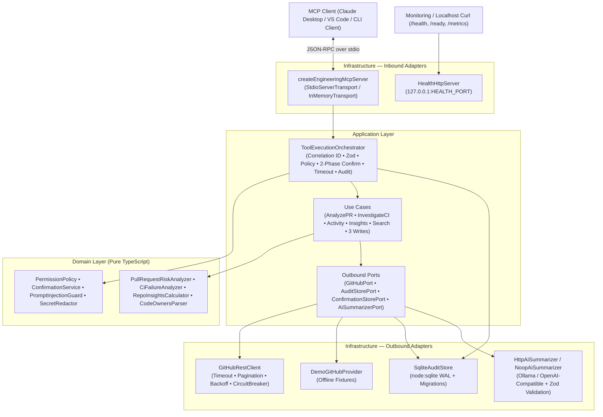
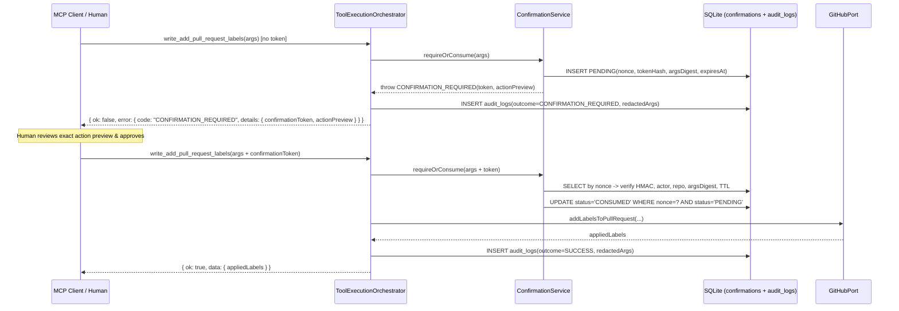

# Engineering Intelligence MCP Server

A production-grade Model Context Protocol (MCP) server for **GitHub Engineering Intelligence** built with TypeScript, hexagonal architecture, server-side permission governance, cryptographic two-phase write confirmation, prompt-injection defense, and persistent SQLite audit logging.

---

## 1. Overview & Problem Statement

Engineering teams increasingly connect AI assistants to GitHub repositories to review pull requests, triage CI failures, track release cadence, and file follow-up issues. Naive GitHub MCP wrappers introduce four major production hazards:

1. **Unrestricted writes:** AI agents with write tokens can accidentally post comments, alter labels, or create issues without explicit human sign-off.
2. **Indirect prompt injection:** Adversaries can embed malicious directives inside PR descriptions, issue bodies, commit messages, or CI logs to hijack downstream LLMs or exfiltrate secrets.
3. **Brittle API integration:** Missing timeouts, unhandled `429`/`Retry-After` rate limits, unbounded pagination, and lack of circuit breakers cause cascading failures.
4. **Zero auditability:** Teams cannot answer *who* invoked *which* tool, on *which* repository, with *what* outcome, or whether adversarial content was encountered.

`engineering-intelligence-mcp` solves these problems with deterministic-first engineering analysis, defense-in-depth security controls, and an offline demonstration mode so engineers can evaluate every capability locally before connecting a live GitHub token.

---

## 2. Key Capabilities

- **Pull Request Risk & Ownership Analysis (`analyze_pull_request`):** Evaluates diff size, changed file count, security/infrastructure-sensitive paths, missing test coverage, stale reviews, `CHANGES_REQUESTED`, failing/pending CI checks, `.github/CODEOWNERS` ownership mapping, and prompt-injection hazards.
- **CI Failure Investigation (`investigate_ci_failures`):** Aggregates GitHub Actions workflow runs and failed jobs, groups recurring failure signatures, classifies root-cause categories (`TEST_FAILURE`, `LINT_OR_TYPECHECK`, `BUILD_OR_DEPENDENCY`, `INFRA_OR_TIMEOUT`, `SECURITY_OR_POLICY`), and correlates failing runs to recent commits by `headSha`.
- **Engineering Activity Summary (`read_engineering_activity`):** Summarizes commits, merged PRs, opened/closed issues, top authors, and published releases across a bounded window.
- **Repository Health Insights (`read_repo_insights`):** Computes median/average PR cycle time, stale open PRs, contributor concentration & estimated bus factor, CI pass rate, issue backlog pressure ratio, release cadence, and an overall composite health score.
- **Filtered Issue & PR Search (`read_search_issues_and_prs`):** Paginated, filtered search over repository issues and pull requests with sanitized and fenced text excerpts.
- **Confirmed GitHub Writes (`write_create_issue_comment`, `write_create_issue`, `write_add_pull_request_labels`):** Blocked by default (`PERMISSION_MODE=read-only`); when enabled (`write-with-confirmation`), every mutation requires an HMAC-signed, argument-bound, single-use confirmation token.
- **MCP Resources:** Exposes `engineering://repo/{owner}/{repo}/overview`, `engineering://audit/recent`, and `engineering://health`.
- **Optional LLM Executive Summaries:** Pluggable `AiSummarizerPort` supporting Ollama, OpenAI-compatible APIs, or deterministic fallback (`AI_PROVIDER=none`).

---

## 3. Architecture Overview

The codebase follows **Hexagonal (Ports & Adapters) Architecture** with strict dependency inversion: `domain` has zero framework dependencies, `application` orchestrates use cases against narrow ports, and `infrastructure` implements MCP transport, GitHub REST/Demo providers, SQLite persistence, optional HTTP AI summarization, and observability.



See [`docs/ARCHITECTURE.md`](docs/ARCHITECTURE.md) for detailed component boundaries.

---

## 4. Repository & Folder Structure

```text
applications/engineering-intelligence-mcp/
├── src/
│   ├── index.ts                             # Composition root, stdio MCP server, graceful shutdown
│   ├── cli/demo-client.ts                   # Real @modelcontextprotocol/sdk stdio CLI demo client
│   ├── domain/                              # Pure business rules & security invariants
│   │   ├── entities.ts                      # Core domain models & value objects
│   │   ├── errors.ts                        # Structured AppError hierarchy & error codes
│   │   ├── permissionPolicy.ts              # Read-only vs write-with-confirmation + repo allowlist
│   │   ├── confirmationService.ts           # HMAC-SHA256 two-phase single-use confirmation tokens
│   │   ├── promptInjectionGuard.ts          # Multi-vector detector, sanitizer & fence wrapper
│   │   ├── secretRedactor.ts                # Recursive token/key redaction for logs & audit rows
│   │   ├── codeOwnersParser.ts              # GitHub .github/CODEOWNERS glob matcher
│   │   ├── prRiskAnalyzer.ts                # Deterministic PR risk scoring engine
│   │   ├── ciFailureAnalyzer.ts             # CI failure grouping & commit correlation
│   │   └── repoInsightsCalculator.ts        # Bus factor, cycle time, CI pass rate & health score
│   ├── application/
│   │   ├── ports.ts                         # Outbound port interfaces
│   │   ├── schemas.ts                       # Strict Zod input validation schemas
│   │   ├── toolExecutionOrchestrator.ts     # Unified cross-cutting execution pipeline
│   │   └── usecases/                        # 5 read use cases + 3 confirmed write use cases
│   ├── infrastructure/
│   │   ├── config/env.ts                    # Startup Zod environment config validation
│   │   ├── github/                          # GitHubRestClient, CircuitBreaker, DemoGitHubProvider
│   │   ├── audit/SqliteAuditStore.ts        # node:sqlite persistent store + schema migrations
│   │   ├── ai/HttpAiSummarizer.ts           # Ollama / OpenAI-compatible client + Noop fallback
│   │   ├── observability/                   # JSON stderr logger, Prometheus metrics, HealthHttpServer
│   │   └── mcp/createMcpServer.ts           # MCP tool & resource registration
│   └── evals/runEvals.ts                    # Offline evaluation runner
├── evals/dataset.json                       # Fixed prompt-injection, schema, PR & CI eval dataset
├── tests/
│   ├── unit/                                # 7 domain & resilience unit test suites
│   ├── contract/                            # Real node:http mock GitHub API contract tests
│   ├── integration/                         # InMemoryTransport MCP protocol + stdio E2E tests
│   └── evals/                               # Automated eval thresholds & mock LLM tests
├── docs/                                    # Architecture, MCP interface, security, eval, ops, ADR
├── Dockerfile                               # Multi-stage non-root node:22.15-alpine image
├── compose.yaml                             # Localhost-bound compose stack + optional Ollama profile
└── .env.example                             # Documented environment template
```

---

## 5. Tech Stack & Runtime Requirements

- **Runtime:** Node.js `>= 22.13.0` (verified on Node `v22` in CI and local Node `v26.8.1`). Uses Node's built-in `node:sqlite` (`DatabaseSync`) — zero native C++ compilation required.
- **Language:** TypeScript `5.8` (strict mode, ESM `NodeNext`).
- **MCP Protocol:** Official `@modelcontextprotocol/sdk` (`McpServer`, `StdioServerTransport`, `InMemoryTransport`, `Client`, `StdioClientTransport`).
- **Validation:** `zod` for startup config, MCP tool inputs, and optional LLM JSON outputs.
- **Testing & Linting:** `vitest`, `eslint` + `typescript-eslint`, `tsc --noEmit`.

---

## 6. MCP Tools & Resources Reference

### Tools

| Tool Name | Class | `readOnlyHint` | Confirmation Required | Purpose |
|---|---|---|---|---|
| `analyze_pull_request` | `READ` | `true` | No | PR risk score, sensitive paths, CODEOWNERS, checks, reviews, injection scan |
| `investigate_ci_failures` | `READ` | `true` | No | Group recurring GitHub Actions failures & link suspicious commits |
| `read_engineering_activity` | `READ` | `true` | No | Windowed summary of commits, merged PRs, issues, and releases |
| `read_repo_insights` | `READ` | `true` | No | PR cycle time, stale PRs, bus factor, CI pass rate, backlog, health score |
| `read_search_issues_and_prs` | `READ` | `true` | No | Filtered, paginated issue/PR search with fenced untrusted excerpts |
| `write_create_issue_comment` | `WRITE` | `false` | **Yes (2-phase)** | Post a comment on an issue or PR |
| `write_create_issue` | `WRITE` | `false` | **Yes (2-phase)** | Open a new repository issue |
| `write_add_pull_request_labels` | `WRITE` | `false` | **Yes (2-phase)** | Apply labels to a pull request |

### Resources

| URI / Template | Description |
|---|---|
| `engineering://repo/{owner}/{repo}/overview` | Sanitized repository overview, open PR count, and latest release |
| `engineering://audit/recent` | Latest 25 redacted SQLite audit trail records |
| `engineering://health` | Live server health status, circuit breaker state, and metrics snapshot |

Full payload schemas and examples are documented in [`docs/MCP_INTERFACE.md`](docs/MCP_INTERFACE.md).

---

## 7. Security Model & Guardrails

1. **Read-Only by Default:** `PERMISSION_MODE` defaults to `read-only`, unconditionally rejecting all `WRITE` tools with `PERMISSION_DENIED`.
2. **Repository Allowlist:** `ALLOWED_REPOS` restricts both tools and resources to explicitly approved `owner/repo` pairs.
3. **Two-Phase Cryptographic Write Confirmation:** When `PERMISSION_MODE=write-with-confirmation`, calling any write tool without `confirmationToken` never mutates GitHub. It persists a `PENDING` confirmation record in SQLite and returns `CONFIRMATION_REQUIRED` with a preview and HMAC-SHA256 token bound to `(nonce, toolName, actor, repo, sha256(canonicalArgs), expiresAt)`. Re-invoking with identical arguments and the token atomically consumes the token (`UPDATE ... WHERE status = 'PENDING'`) and blocks replays or argument tampering.
4. **Prompt-Injection Defense:** All untrusted GitHub text is scanned in a two-pass detector (instruction overrides, role/delimiter smuggling, tool smuggling, secret exfiltration, hidden HTML comments, invisible/bidi Unicode), redacted, escaped against fence breakout, and wrapped in `<untrusted_github_content>` tags.
5. **Secret Redaction:** `GITHUB_TOKEN`, `Bearer` headers, OpenAI keys, and confirmation tokens are recursively scrubbed from logs, errors, and SQLite audit rows.



See [`docs/SECURITY.md`](docs/SECURITY.md) and [`docs/adr/ADR-001-two-phase-write-confirmation.md`](docs/adr/ADR-001-two-phase-write-confirmation.md).

---

## 8. Configuration & Environment Variables

Copy `.env.example` to `.env` or export environment variables directly. All values are validated at startup via `src/infrastructure/config/env.ts` (Zod).

| Variable | Default | Description |
|---|---|---|
| `GITHUB_MODE` | `demo` | `demo` (offline fixtures) or `live` (GitHub REST API v3) |
| `GITHUB_TOKEN` | `""` | Fine-grained PAT; **required** when `GITHUB_MODE=live` |
| `GITHUB_API_BASE_URL` | `https://api.github.com` | Override for GitHub Enterprise Server or local mock |
| `GITHUB_TIMEOUT_MS` | `10000` | Per-request `AbortController` timeout (ms) |
| `GITHUB_MAX_RETRIES` | `3` | Retry count on `429`/5xx/network failures |
| `GITHUB_MAX_PAGES` | `5` | Hard ceiling on `Link` header pagination pages |
| `PERMISSION_MODE` | `read-only` | `read-only` or `write-with-confirmation` |
| `ALLOWED_REPOS` | `""` | Optional comma-separated `owner/repo` allowlist |
| `ACTOR_ID` | `local-developer` | Actor identity written to audit logs & confirmation bindings |
| `CONFIRMATION_SECRET` | *(ephemeral random)* | Min 16-char HMAC secret (set explicitly to survive restarts) |
| `CONFIRMATION_TTL_SECONDS` | `300` | Validity window for confirmation tokens (30–3600s) |
| `AUDIT_DB_PATH` | `./data/audit.db` | SQLite database path (or `:memory:`) |
| `AI_PROVIDER` | `none` | `none`, `ollama`, or `openai-compatible` |
| `AI_BASE_URL` | `http://127.0.0.1:11434` | LLM endpoint base URL |
| `AI_MODEL` | `llama3.2:1b` | Model identifier |
| `AI_API_KEY` | `""` | Optional Bearer token for OpenAI-compatible providers |
| `AI_TIMEOUT_MS` | `15000` | LLM request timeout (ms) |
| `HEALTH_PORT` | `0` | Local HTTP health/metrics port (`0` disables HTTP listener) |
| `HEALTH_HOST` | `127.0.0.1` | Bind address for optional health server |
| `LOG_LEVEL` | `info` | `debug`, `info`, `warn`, or `error` (JSON emitted to `stderr`) |

---

## 9. Quick Start (Local Demo Mode — Zero Token Required)

```bash
cd applications/engineering-intelligence-mcp
npm install
npm run build

# Run the real stdio MCP client-server demonstration against offline fixtures:
npm run cli -- demo
```

The demo spawns `node dist/index.js` over stdio, discovers all 8 tools and resources, analyzes high-risk PR `#142` and prompt-injected PR `#145`, diagnoses CI failures, computes repo health insights, proves writes are blocked in `read-only` mode, demonstrates the full two-phase write confirmation + replay rejection flow, and reads persisted audit logs from SQLite.

---

## 10. Running Against Live GitHub API

Create a fine-grained Personal Access Token with least-privilege permissions (`Metadata: Read`, `Pull requests: Read`, `Actions: Read`, `Contents: Read`, `Issues: Read`; add `Issues/Pull requests: Write` only if enabling confirmed writes):

```bash
export GITHUB_MODE=live
export GITHUB_TOKEN="github_pat_..."
export PERMISSION_MODE=read-only
export ALLOWED_REPOS="your-org/your-repo"
npm run build && npm start
```

---

## 11. Optional Local / Remote AI Summarization

By default (`AI_PROVIDER=none`), the server produces fast, 100% deterministic summaries with zero LLM dependency. To enable optional LLM executive summaries over deterministic telemetry + fenced untrusted snippets:

```bash
# Local Ollama
export AI_PROVIDER=ollama
export AI_BASE_URL=http://127.0.0.1:11434
export AI_MODEL=llama3.2:1b

# Or OpenAI-compatible API
export AI_PROVIDER=openai-compatible
export AI_BASE_URL=https://api.openai.com
export AI_MODEL=gpt-4o-mini
export AI_API_KEY="sk-..."
```

Every LLM response is validated against `LlmStructuredSummarySchema` (Zod). Malformed JSON, schema mismatches, or upstream timeouts transparently degrade to the deterministic fallback (`usedFallback: true`).

---

## 12. Connecting to MCP Clients

### Claude Desktop / MCP Host JSON Configuration

```json
{
  "mcpServers": {
    "engineering-intelligence": {
      "command": "node",
      "args": ["/absolute/path/to/applications/engineering-intelligence-mcp/dist/index.js"],
      "env": {
        "GITHUB_MODE": "demo",
        "PERMISSION_MODE": "read-only",
        "AUDIT_DB_PATH": "/absolute/path/to/applications/engineering-intelligence-mcp/data/audit.db"
      }
    }
  }
}
```

### Included CLI Commands

```bash
npm run cli -- demo
npm run cli -- tools
npm run cli -- analyze-pr acme-eng payments-platform 142
```

---

## 13. Docker & Docker Compose Deployment

The `Dockerfile` uses a pinned multi-stage `node:22.15-alpine` build running as non-root user `node`. `compose.yaml` binds the health/metrics port strictly to `127.0.0.1:8081`, mounts a persistent SQLite volume, enforces `read_only: true` root filesystem with `cap_drop: [ALL]` and `no-new-privileges:true`, and offers an optional `ollama` profile.

```bash
# Validate Compose file
docker compose -f compose.yaml config -q

# Build and start MCP server (health endpoint at http://127.0.0.1:8081/health)
docker compose up --build -d

# Optionally include local Ollama
docker compose --profile ollama up --build -d
```

---

## 14. Testing Strategy

```bash
npm run lint        # ESLint (TypeScript strict rules, no explicit any)
npm run typecheck   # tsc --noEmit
npm test            # Vitest: unit + GitHub HTTP contract + MCP integration + stdio E2E + evals
```

- **Unit tests (`tests/unit/`):** PR risk analyzer, CODEOWNERS parser, permission policy, confirmation service lifecycle, prompt-injection guard, circuit breaker, secret redactor.
- **Contract tests (`tests/contract/`):** Real `node:http` mock GitHub server testing `Link` pagination, `401` auth failures, `403`/`429` rate limits + `Retry-After`, transient `500` retry recovery, `AbortController` timeouts, circuit breaker `OPEN` state, and token non-leakage.
- **Integration & E2E tests (`tests/integration/`):** Real `@modelcontextprotocol/sdk` `Client` over `InMemoryTransport` and real subprocess `StdioClientTransport`, verifying tool/resource discovery, Zod errors, permission denial, 2-phase confirmation, adversarial PR/issue handling, SQLite audit persistence, and HTTP `/health` & `/metrics`.

---

## 15. Offline AI & Prompt-Injection Evaluation Suite

```bash
npm run eval
```

Evaluates fixed fixtures in `evals/dataset.json` across four quality gates (also enforced inside Vitest):
- Prompt-injection detection recall, precision, F1, and fence-breakout resistance (16 labeled cases).
- LLM structured JSON schema validation and unreachable-provider fallback recovery (5 cases + fault injection).
- Deterministic PR risk diagnosis accuracy (3 cases).
- Deterministic CI failure categorization accuracy (3 cases).

See [`docs/EVALUATION.md`](docs/EVALUATION.md).

---

## 16. Observability, Health Checks & Metrics

- **Structured JSON Logging (`stderr` only):** Every tool invocation logs `correlationId`, `actor`, `toolName`, `permissionClass`, `repository`, `outcome`, `durationMs`, and `injectionWarningsCount` to `process.stderr` (never `stdout`, keeping MCP stdio JSON-RPC framing clean).
- **Optional Localhost HTTP Server (`HEALTH_PORT=8081`):**
  - `GET /health` and `GET /ready` — JSON health status including GitHub circuit state & SQLite audit record count.
  - `GET /metrics` — Prometheus exposition format (`mcp_tool_executions_total`, `mcp_tool_duration_ms_sum`, `mcp_prompt_injection_warnings_total`, `mcp_upstream_requests_total`, `github_rate_limit_remaining`).

See [`docs/OPERATIONS.md`](docs/OPERATIONS.md).

---

## 17. Persistence & Audit Trail Schema

`SqliteAuditStore` uses Node's built-in `node:sqlite` (`DatabaseSync`) with WAL mode (`PRAGMA journal_mode = WAL`), `busy_timeout = 5000`, and versioned transactional SQL migrations (`schema_migrations`):

- **`audit_logs`:** Immutable append-only record of every tool execution (`correlation_id`, `timestamp`, `actor`, `tool_name`, `permission_class`, `repository`, `outcome`, `error_code`, `duration_ms`, `injection_warnings_count`, `redacted_args_json`, `summary`).
- **`confirmations`:** Two-phase confirmation ledger (`nonce`, `token_hash`, `tool_name`, `actor`, `repository`, `args_digest`, `action_preview`, `status`, `created_at`, `expires_at`, `consumed_at`).

---

## 18. Resilience: Rate Limiting, Retries & Circuit Breaker

`GitHubRestClient` protects upstream calls with:
- Per-request `AbortController` timeouts (`GITHUB_TIMEOUT_MS`).
- Bounded `Link` pagination (`GITHUB_MAX_PAGES`).
- Rate-limit header telemetry (`X-RateLimit-Remaining`, `X-RateLimit-Reset`, `Retry-After`) and detection of both `429` and secondary `403` rate limits.
- Exponential backoff with jitter for idempotent `GET` retries on `429`/5xx/network failures (never retrying `401`, non-rate-limit `403`, `404`, or `422`, and never auto-retrying `POST` writes).
- 3-state `CircuitBreaker` (`CLOSED` -> `OPEN` -> `HALF_OPEN`) that fails fast with `CIRCUIT_OPEN` during GitHub outages.

---

## 19. CI/CD Pipeline

The path-filtered GitHub Actions workflow `.github/workflows/engineering-intelligence-mcp.yml` runs on every push/PR touching this application:
1. `npm ci`, `npm run lint`, `npm run typecheck`, `npm run build`
2. `npm test` (unit, contract, integration, E2E, evals)
3. `npm run eval` (offline evaluation thresholds)
4. `npm run cli -- demo` (real stdio client-server smoke test)
5. `docker compose -f compose.yaml config -q` & `docker build`

---

## 20. Architectural Decisions & Trade-offs

- **Deterministic-first analysis over LLM-only scoring:** Risk scores, CODEOWNERS matches, CI failure grouping, and repo health metrics are computed deterministically so outputs remain auditable, reproducible, and cheap; LLMs only synthesize optional executive narratives.
- **Built-in `node:sqlite` over native addons:** Avoids platform-specific `node-gyp` build failures across Node 22/26 and Alpine containers while providing ACID WAL persistence.
- **Server-enforced two-phase confirmation over client-side prompts:** Even if an MCP client or LLM is compromised via prompt injection, the server refuses any write without a freshly issued, argument-bound, single-use confirmation token. See [`docs/adr/ADR-001-two-phase-write-confirmation.md`](docs/adr/ADR-001-two-phase-write-confirmation.md).

---

## 21. Roadmap & Related Documentation

- **Detailed Architecture:** [`docs/ARCHITECTURE.md`](docs/ARCHITECTURE.md)
- **MCP Tool & Resource Contracts:** [`docs/MCP_INTERFACE.md`](docs/MCP_INTERFACE.md)
- **Threat Model & Security Controls:** [`docs/SECURITY.md`](docs/SECURITY.md)
- **Evaluation Methodology & Metrics:** [`docs/EVALUATION.md`](docs/EVALUATION.md)
- **Operations & Runbook:** [`docs/OPERATIONS.md`](docs/OPERATIONS.md)
- **ADR-001 (Two-Phase Confirmation):** [`docs/adr/ADR-001-two-phase-write-confirmation.md`](docs/adr/ADR-001-two-phase-write-confirmation.md)
