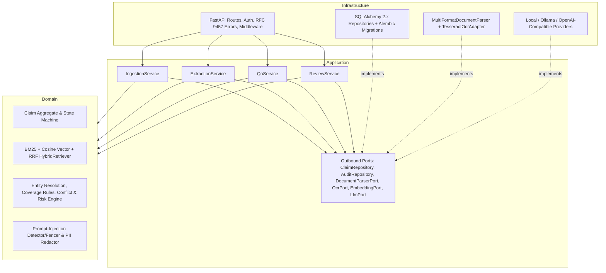

# Architecture Guide — Insurance Claims Intelligence

## 1. Hexagonal Layering

## 2. Core Design Decisions

1. **Zero Framework Coupling in `domain/`:** Domain aggregates, retrieval math, deterministic extraction rules, risk indicators, prompt-injection detection, and PII redaction depend only on Python stdlib + Pydantic models.
2. **Claim-Scoped Content-Addressed Atomic Ingestion:** Uploaded files are SHA-256 hashed and assigned a claim-scoped deterministic ID (`doc-{sha256(claim_id:content_sha256)[:12]}`) with deterministic chunk IDs (`{document_id}:p{page}:c{ordinal}`). `SqlAlchemyClaimRepository.save_document_and_chunks` inserts the document and all chunks atomically in a single transaction, rolling back cleanly on mid-persistence faults and resolving concurrent identical uploads via `uq_claim_doc_sha256` (`DuplicateDocumentError` -> deduplicated return) while keeping identical files uploaded to different claims isolated.
3. **Page, Offset, and Quote Provenance:** Every `EvidenceChunk` and `EvidenceRef` stores `document_id`, `filename`, `page_number` (1-based), `char_start`, and `char_end`. Both `QaService` and `ExtractionService` verify every cited quote against the specific cited chunk's text (substring, ellipsis-segment, or strict numeric + lexical overlap), rejecting fabricated, numerically altered, or cross-chunk misattributed quotes.
4. **Deterministic-First Pipeline:** Authoritative extraction, entity resolution, policy coverage checks, conflict detection, missing-evidence checks, and weighted risk scoring run deterministically before any advisory LLM synthesis.
5. **Explicit Composition Root:** `AppContainer` (`infrastructure/api/dependencies.py`) wires all repositories, parsers, AI providers, and services during FastAPI lifespan startup and disposes connections cleanly on shutdown.
