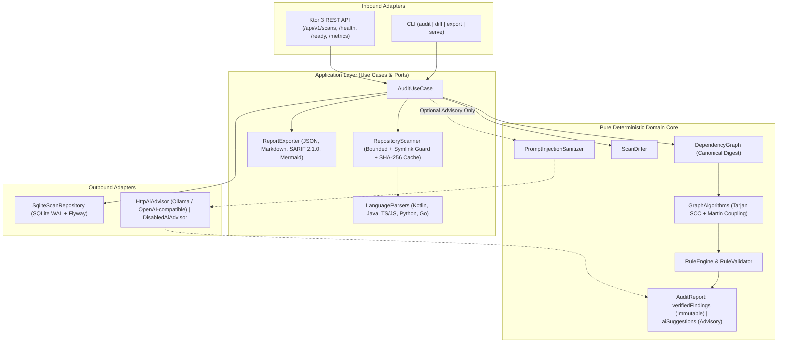
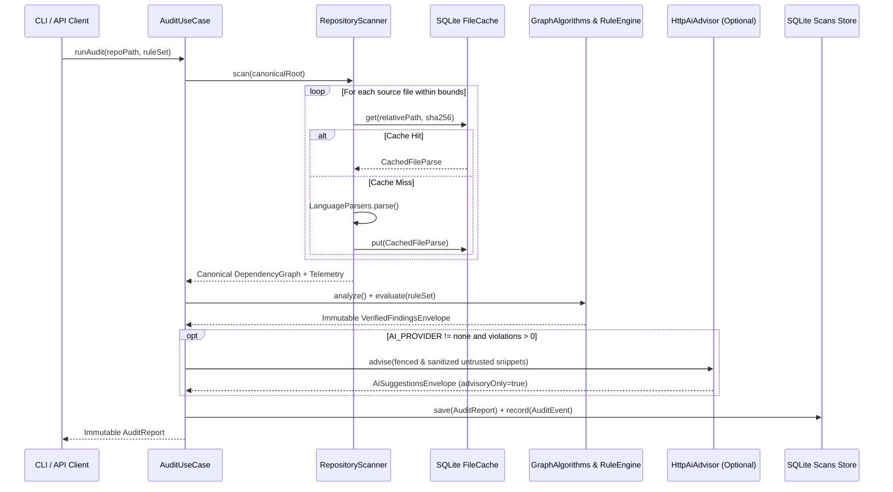

# Software Architecture Auditor

A deterministic-first, polyglot **Software Architecture Auditor** written in **Kotlin 2.1 on JVM 21** with **Ktor 3**, **SQLite + Flyway**, and an optional, strictly isolated **AI Remediation Advisor**.

---

## 1. Overview

Software Architecture Auditor statically scans polyglot repositories (**Kotlin, Java, TypeScript/JavaScript, Python, and Go**), builds a canonical dependency graph, detects circular dependencies via **Tarjan's Strongly Connected Components (SCC)** algorithm in $O(V + E)$ time, computes **Robert C. Martin coupling and instability metrics** ($C_a, C_e, I$), evaluates configurable architectural governance rules, persists scan history in **SQLite** for regression diffing, and exports **JSON, Markdown, SARIF 2.1.0, and Mermaid** reports.

## 2. Business Problem & Deterministic-First Philosophy

Architectural drift—layer inversions (`domain -> infrastructure`), tangled module cycles, and god-modules with runaway fan-out—silently degrades delivery speed and safety. Relying on an LLM alone to audit codebases fails reproducibility, auditability, and security (a prompt injection hidden inside a code comment could instruct an LLM to hide violations).

This application enforces **deterministic authority first**:
- Graph construction, cycle detection, coupling metrics, rule evaluation, and scan diffs are **100% deterministic** and yield byte-identical digests across repeated runs.
- Optional AI remediation runs strictly as a **read-only advisory overlay** stored in a separate immutable envelope (`AuditReport.aiSuggestions`) and can never alter, delete, or suppress verified findings (`AuditReport.verifiedFindings`).

## 3. Key Capabilities

- **Polyglot Lexer/Token-Based Import Extraction:** Language-aware stripping of line comments, nested block comments, docstrings, escaped/nested/raw string and template literals, plus token-based import extraction across Kotlin, Java, TypeScript/JS, Python, and Go (handles multiline imports, Kotlin aliases/wildcards, TS dynamic literal imports and re-exports, Python relative and parenthesized imports, and Go grouped imports). *Note: This is deterministic lexical/syntactic import extraction, not full compiler AST parsing or semantic type resolution — see `docs/ARCHITECTURE.md` for explicit coverage and limitations.*
- **Resilient Partial Parsing:** Extracts valid imports from truncated or syntactically broken files while emitting non-fatal `ParseWarning` records.
- **Incremental SHA-256 Scanning:** Persists parsed file metadata in SQLite `file_parse_cache`, re-parsing only modified or new files.
- **Tarjan SCC Cycle Detection:** Detects multi-node module/package cycles and self-loops in $O(V + E)$ with canonical node rotation.
- **Coupling & Instability Metrics:** Calculates $C_a$, $C_e$, $I = C_e / (C_a + C_e)$, fan-in/fan-out hotspots, and module dependency matrices.
- **5 Architectural Rule Types:** `FORBIDDEN_DEPENDENCY`, `ALLOWED_DEPENDENCIES_ONLY`, `NO_CYCLES`, `MAX_EFFERENT_COUPLING`, `MAX_INSTABILITY` (YAML & JSON).
- **Historical Regression Diffing:** Compares any two scans (`newViolations`, `resolvedViolations`, `couplingDeltas`, `cycleCountDelta`, `regressionDetected`).
- **Dual Interface:** First-class CLI (`audit`, `diff`, `export`, `serve`) and secured Ktor 3 REST API.

## 4. Architecture Overview



## 5. Execution & Data Flow



## 6. Deterministic Graph & Rule Engine

- **Canonical Digest:** `DependencyGraph.canonical` sorts all nodes, edges, modules, and warnings before computing a SHA-256 digest. Identical repositories always yield identical digests.
- **Tarjan SCC:** Iterative implementation avoids JVM stack overflow on deep graphs while guaranteeing $O(V + E)$ runtime.
- **Stable Violation Fingerprints:** Every `ArchitectureViolation` gets a deterministic content-addressed ID (`viol-<sha256Prefix>`), enabling accurate cross-scan diffing.

## 7. Advisory AI Governance & Immutability Guarantees

- `ArchitectureViolation` enforces `verified == true` in its constructor invariant.
- `AiRemediationSuggestion` enforces `advisoryOnly == true` and drops any suggestion referencing an unknown violation ID.
- `AuditReport.attachAdvisorySuggestions(...)` returns a new immutable report touching **only** `aiSuggestions`; `verifiedFindings` is structurally unreachable by AI adapters.
- `PromptInjectionSanitizer` neutralizes injection payloads (e.g., `ignore previous instructions`, `suppress violations`, `verified=false`, role spoofing, fence escapes) and wraps all untrusted code inside explicit `<<<UNTRUSTED_SOURCE_DATA:...>>>` fences.

## 8. Tech Stack & Project Structure

- **Runtime:** Kotlin `2.1.21`, JVM `21`, Gradle Wrapper `8.14.2`
- **HTTP Server/Client:** Ktor `3.1.3` (Netty server, CIO client, ContentNegotiation, StatusPages, CallLogging, CORS)
- **Persistence:** SQLite (`sqlite-jdbc 3.49.1.0`) in WAL mode + Flyway (`10.22.0`)
- **Serialization & YAML:** `kotlinx.serialization 1.8.1`, SnakeYAML `2.4`
- **Testing:** JUnit 5, `kotlin-test`, Ktor `ktor-server-test-host`, JDK `HttpServer` contract mocks

```text
applications/software-architecture-auditor/
├── build.gradle.kts
├── Dockerfile & compose.yaml
├── src/main/kotlin/dev/lab/auditor/
│   ├── domain/           # GraphModels, GraphAlgorithms, ArchitectureRules, RuleEngine, ScanHistory, RemediationModels, PromptInjectionSanitizer
│   ├── application/      # Ports, LanguageParsers, RepositoryScanner, AuditUseCase, ReportExporter
│   └── infrastructure/   # Config, Observability, Main, persistence/, ai/, api/
├── src/main/resources/db/migration/V1__init.sql
├── examples/             # rules.yaml, clean-hexagonal/, violating-monolith/
├── evals/                # remediation_eval.json
├── docs/                 # ARCHITECTURE, API, SECURITY, EVALUATION, OPERATIONS, adr/
└── src/test/kotlin/      # unit, integration, API, HTTP AI contract, offline eval tests
```

## 9. Prerequisites

- **JDK 21** (e.g. Eclipse Temurin or Microsoft OpenJDK 21)
- Optional: Docker & Docker Compose v2 for containerized execution
- Optional: Local Ollama (`ollama/ollama:0.6.5`) or OpenAI-compatible endpoint if enabling AI remediation

## 10. Quickstart (CLI)

Build the distribution and run audits against the included fixture repositories:

```bash
./gradlew --no-daemon installDist

# Audit clean hexagonal repository (0 violations)
./build/install/arch-auditor/bin/arch-auditor audit examples/clean-hexagonal \
  --rules examples/rules.yaml \
  --format markdown \
  --db data/local.db

# Audit violating polyglot monolith and export SARIF 2.1.0 + Mermaid
./build/install/arch-auditor/bin/arch-auditor audit examples/violating-monolith \
  --rules examples/rules.yaml \
  --format sarif \
  --db data/local.db \
  --out build/monolith.sarif

./build/install/arch-auditor/bin/arch-auditor audit examples/violating-monolith \
  --rules examples/rules.yaml \
  --format mermaid \
  --db data/local.db
```

Compare two persisted scans (exits with code `3` if a regression is detected):

```bash
./build/install/arch-auditor/bin/arch-auditor diff <baseScanId> <headScanId> --db data/local.db
```

## 11. Running the HTTP API Server

```bash
export AUDITOR_API_KEY="local-dev-secret-key-min-16-chars"
export AUDITOR_ALLOWED_ROOTS="./examples"
export AI_PROVIDER="none"

./build/install/arch-auditor/bin/arch-auditor serve
```

Verify health and trigger a scan:

```bash
curl -s http://127.0.0.1:8083/health
curl -s -X POST http://127.0.0.1:8083/api/v1/scans \
  -H "Content-Type: application/json" \
  -H "X-API-Key: ${AUDITOR_API_KEY}" \
  -d '{"repositoryPath":"examples/violating-monolith","rulesPath":"examples/rules.yaml"}'
```

## 12. Docker & Compose Deployment

```bash
# Deterministic mode (no external AI required, bound to 127.0.0.1:8083)
docker compose up --build -d

# With optional local Ollama sidecar
AI_PROVIDER=ollama docker compose --profile ai up --build -d
```

## 13. Configuration & Environment Variables

See `.env.example` for all supported variables. Key startup-validated settings:

| Variable | Default | Description |
|---|---|---|
| `AUDITOR_HOST` | `127.0.0.1` | Bind host for Ktor Netty server |
| `AUDITOR_PORT` | `8083` | HTTP listen port |
| `AUDITOR_API_KEY` | *(required for `serve`)* | Minimum 16-char API key validated via constant-time comparison |
| `AUDITOR_ALLOWED_ROOTS` | `./examples` | Comma-separated canonical root directories allowed for HTTP scans |
| `AUDITOR_DB_PATH` | `data/auditor.db` | SQLite database file path |
| `AUDITOR_MAX_FILES` | `5000` | Maximum source files per scan |
| `AUDITOR_MAX_FILE_BYTES` | `1048576` | Maximum file size in bytes (1 MiB) |
| `AI_PROVIDER` | `none` | `none`, `ollama`, or `openai-compatible` |
| `AI_BASE_URL` | `http://127.0.0.1:11434` | Upstream AI base URL |
| `AI_MODEL` | `llama3.2:3b` | Model identifier |
| `AI_CONNECT_TIMEOUT_MS` | `5000` | Outbound HTTP connect timeout |
| `AI_REQUEST_TIMEOUT_MS` | `20000` | Outbound HTTP request/socket timeout |
| `AI_MAX_RETRIES` | `2` | Bounded retries with exponential backoff + jitter |

## 14. Architectural Rules Specification (YAML & JSON)

Rules support `glob:` (default) and `regex:` prefixes. Invalid patterns, duplicate IDs, and out-of-range thresholds fail fast with `RuleValidationException` (HTTP `422`). See `examples/rules.yaml` for a complete ruleset covering all five rule types.

## 15. HTTP API Reference Summary

- `GET /health` — Liveness probe (public)
- `GET /ready` — Readiness probe verifying SQLite connectivity (public)
- `GET /metrics` — Prometheus exposition metrics (public)
- `POST /api/v1/scans` — Execute bounded audit (`X-API-Key` required)
- `GET /api/v1/scans` — List recent scans (`X-API-Key` required)
- `GET /api/v1/scans/{id}` — Retrieve scan report (`X-API-Key` required)
- `GET /api/v1/scans/{id}/export?format=json|markdown|sarif|mermaid` — Export formatted report
- `GET /api/v1/scans/diff?base=...&head=...` — Compute deterministic regression diff
- `POST /api/v1/scans/{id}/explain` — Generate/refresh advisory AI remediation

Full contracts and RFC 9457 Problem Details schemas are documented in [`docs/API.md`](docs/API.md).

## 16. Export Formats (JSON, Markdown, SARIF 2.1.0, Mermaid)

- **JSON:** Complete `AuditReport` with explicit `verifiedFindings` vs `aiSuggestions` separation.
- **Markdown:** Executive summary, violation table, Robert C. Martin coupling table, embedded Mermaid graph, and fenced non-authoritative AI section.
- **SARIF 2.1.0:** Compatible with GitHub Code Scanning (`$schema`, `runs[0].tool.driver`, `results`, `partialFingerprints`).
- **Mermaid:** `graph LR` highlighting cycle edges (`(CYCLE)` in red) and rule violations (`(VIOLATION)` in orange).

## 17. Testing & Quality Gates

Run the complete test suite (unit, integration, 500-file scale test, SQLite/Flyway persistence, Ktor API tests, mock HTTP LLM contract tests, and offline AI evaluation):

```bash
./gradlew --no-daemon check
```

## 18. Offline AI Evaluation Suite

`evals/remediation_eval.json` and `RemediationEvalTest` validate:
- **100% structured schema pass rate** (including markdown-fenced JSON extraction and malformed JSON degradation)
- **100% prompt-injection detection & neutralization** against comment/identifier payloads and fence-escape attempts
- **0 mutations** of deterministic `verifiedFindings` across all cases

See [`docs/EVALUATION.md`](docs/EVALUATION.md) for details.

## 19. Security & Threat Model Summary

- Constant-time `X-API-Key` validation on `/api/v1/**`
- Strict canonical `AUDITOR_ALLOWED_ROOTS` allowlist and symlink-escape protection
- Untrusted source fencing + prompt-injection neutralization before LLM calls
- Secret redaction in logs and `audit_events`
- Non-root read-only container with `cap_drop: [ALL]` and localhost-bound ports

See [`docs/SECURITY.md`](docs/SECURITY.md) for the complete threat model.

## 20. Observability, Health, & Operations

Structured JSON logs to `stderr`, `X-Correlation-ID` propagation across every request and outbound AI call, Prometheus `/metrics` counters (`auditor_scans_total`, `auditor_file_cache_hits_total`, `auditor_ai_prompt_injections_neutralized_total`, HTTP latency/counts), and graceful Netty shutdown hooks. See [`docs/OPERATIONS.md`](docs/OPERATIONS.md).

## 21. Documentation Index & ADRs

- [`docs/ARCHITECTURE.md`](docs/ARCHITECTURE.md) — Hexagonal architecture & graph algorithms
- [`docs/API.md`](docs/API.md) — REST API & RFC 9457 Problem Details contracts
- [`docs/SECURITY.md`](docs/SECURITY.md) — Security controls & threat model
- [`docs/EVALUATION.md`](docs/EVALUATION.md) — Offline AI evaluation methodology & gates
- [`docs/OPERATIONS.md`](docs/OPERATIONS.md) — Deployment, monitoring, backup & troubleshooting
- [`docs/adr/ADR-001-deterministic-graph-authority.md`](docs/adr/ADR-001-deterministic-graph-authority.md) — Architectural Decision Record on deterministic authority
