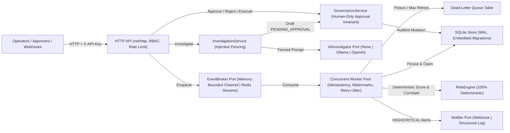
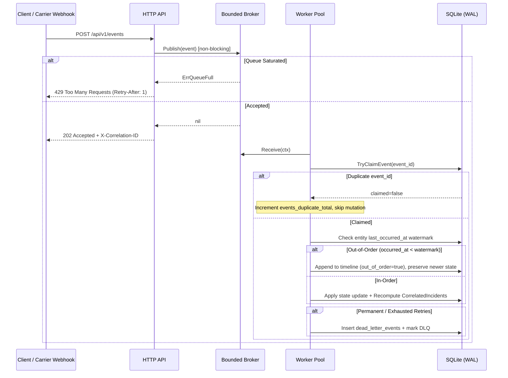

# Supply Chain Risk Intelligence

A deterministic-first, event-driven Go service for global supply-chain risk scoring, inventory shortage projection, cross-entity incident correlation, fenced AI executive investigation, and strictly human-governed operational change execution.

---

## 1. Overview & Purpose

Modern supply chains experience cascading disruptions—a regional substation outage at a Tier-1 single-source supplier compounds port berth congestion, delays container shipments, and threatens warehouse stockouts days before manual spreadsheets detect the gap.

**Supply Chain Risk Intelligence** ingests real-time supply-chain telemetry concurrently via a bounded worker pool, enforces idempotency and out-of-order state protection, computes 100% deterministic risk scores and shortage projections, correlates affected entities into an ordered incident timeline, ranks backup suppliers and routes, and invokes an advisory AI investigator that may only draft `PENDING_APPROVAL` change proposals requiring explicit human approval prior to execution.

---

## 2. Key Capabilities

- **Deterministic Risk & Correlation Engine (`internal/domain/risk_engine.go`):**
  - 0–100 supplier risk scoring (historical delay ratio, active disruption severity, single-source criticality, tier rating).
  - 0–100 route risk scoring (transit delay variance, congestion severity, weather/port incidents, active delayed shipments).
  - Inventory shortage projection (`days_of_cover = on_hand / daily_burn_rate`, delayed inbound ETA gap vs safety stock, projected stockout date, shortfall units).
  - Cross-entity correlation linking disrupted suppliers -> congested routes -> delayed shipments -> impending SKU shortages with chronologically sorted event timelines and ranked backup alternatives.
- **Concurrent Event Processing (`internal/application/processor.go`):**
  - Bounded intake queue with immediate `ErrQueueFull` (HTTP 429) backpressure.
  - Configurable worker pool with graceful shutdown drain.
  - Persistent atomic `event_id` idempotency (`processed_events` table).
  - Per-entity `last_occurred_at` watermarks for out-of-order event protection.
  - Exponential backoff + jitter retries and persistent Dead-Letter Queue (DLQ) with replay.
- **Human-in-the-Loop Governance (`internal/domain/governance.go`):**
  - Strict domain invariants forbid `AI_SYSTEM` from approving, rejecting, or executing change proposals (`ErrAutonomousExecutionForbidden`) and forbid executing unapproved proposals (`ErrApprovalRequired`).
- **Pluggable Adapters:**
  - Pure-Go SQLite (`modernc.org/sqlite`) with WAL mode and embedded versioned SQL migrations.
  - In-process bounded channel broker (default) or Redis Streams broker (`EVENT_BROKER=redis`).
  - Pluggable AI investigator (`AI_PROVIDER=none | ollama | openai`) with prompt-injection fencing, circuit breaker, timeouts, retries, strict JSON schema validation, and graceful degradation.

---

## 3. Architecture Overview

The service follows a strict Hexagonal (Ports & Adapters) architecture with zero framework coupling in `internal/domain`.



---

## 4. Event Processing & Concurrency Model



---

## 5. Deterministic Risk Engine & Correlation Logic

All authoritative calculations run deterministically in `internal/domain/risk_engine.go`:

- **Supplier Score (0–100):** `historical_delay_ratio * 30` + `active_disruption_severity * 0.40` (floor 28 if `DISRUPTED`) + `single_source (15)` + `tier (T1=15, T2=9, T3+=4)`.
- **Route Score (0–100):** `min(delay_variance / 10, 1) * 30` + `congestion * 0.35` + `min(weather_incidents, 5) * 3` + `min(active_delayed_shipments, 5) * 4` (floor 80 if `BLOCKED`).
- **Shortage Detection:** Flags SKUs where `days_of_cover < safety_stock_days`, earliest inbound ETA misses projected stockout date, or inventory is at/below reorder point with delayed inbound shipments. Safely guards zero/negative burn rates without division by zero.
- **Severity Bands:** `<30 LOW`, `30–54 MEDIUM`, `55–74 HIGH`, `>=75 CRITICAL`.

---

## 6. Human-in-the-Loop Governance & AI Safety

- **Draft-Only AI Authority:** `POST /api/v1/incidents/{id}/investigate` can optionally draft a `ChangeProposal` (`REROUTE_SHIPMENT`, `SHIFT_SUPPLIER_ALLOCATION`, or `TRIGGER_EMERGENCY_REORDER`), always initialized in `PENDING_APPROVAL`.
- **Server-Side Human-Only Invariants:**
  - `Approve()` / `Reject()` reject `AI_SYSTEM` or `SYSTEM` actors with `ErrAutonomousExecutionForbidden` (HTTP 403).
  - `MarkExecuted()` requires `Status == APPROVED`, non-empty `ApprovedBy`, and `ApprovedByType == HUMAN`; otherwise returns `ErrApprovalRequired` (HTTP 409) or `ErrAutonomousExecutionForbidden` (HTTP 403).
- **Prompt-Injection Defense:** Untrusted carrier/supplier event notes are scanned for injection patterns, sanitized for control chars and delimiter breakouts, secret-redacted, and wrapped in `<untrusted_data source="...">...</untrusted_data>` fences before any LLM request.

---

## 7. Tech Stack & Dependencies

| Component | Technology | Rationale |
|---|---|---|
| Language | Go 1.24+ (std `net/http`, `log/slog`, `sync`, `database/sql`) | Strong concurrency primitives, zero-bloat stdlib HTTP routing |
| Database | `modernc.org/sqlite` (v1.34.5) | Pure-Go SQLite with WAL mode; zero CGO friction across macOS/Linux/Docker |
| Distributed Broker | `github.com/redis/go-redis/v9` (v9.7.3) | Optional Redis Streams backend for Compose/multi-instance setups |
| Identifiers | `github.com/google/uuid` (v1.6.0) | Correlation IDs, proposal IDs, DLQ/audit IDs |
| AI Providers | Ollama (`/api/chat`) & OpenAI-compatible (`/chat/completions`) | Standard HTTP JSON adapters with circuit breaker & deterministic `none` fallback |

---

## 8. Repository Layout

```text
applications/supply-chain-risk-intelligence/
├── cmd/
│   ├── server/main.go               # HTTP server + worker pool entrypoint (--seed)
│   └── simulator/main.go            # Realistic supply-chain dataset & cascade replay CLI
├── internal/
│   ├── domain/                      # Pure models, RiskEngine, governance invariants, Sanitizer
│   ├── application/                 # Ports, Processor, InvestigationService, GovernanceService, Notifier, Metrics
│   └── infrastructure/
│       ├── config/                  # Startup-validated env configuration
│       ├── sqlite/                  # Pure-Go SQLite store + embedded SQL migrations
│       ├── broker/                  # Bounded MemoryBroker + Redis Streams RedisBroker
│       ├── ai/                      # HTTPInvestigator (Ollama/OpenAI) + NoneInvestigator
│       └── httpapi/                 # /api/v1 routes, RBAC, rate limiting, RFC 9457 errors
├── evals/                           # Offline evaluation dataset & automated test runner
├── docs/                            # Architecture, API, Security, Evaluation, Operations, ADR-001
├── Dockerfile                       # Multi-stage non-root Go build
├── compose.yaml                     # App + Redis 7.4 + optional Ollama profile
└── .env.example                     # Documented environment variables
```

---

## 9. Prerequisites

- **Go 1.24+** (`go version`)
- **Docker & Docker Compose v2** (optional, for containerized / Redis Streams deployment)
- **Ollama** or an OpenAI-compatible API key (optional; defaults to deterministic `AI_PROVIDER=none`)

---

## 10. Quick Start (Local)

```bash
cd applications/supply-chain-risk-intelligence
cp .env.example .env

# Run the HTTP server + worker pool with realistic seed entities loaded
go run ./cmd/server --seed
```

Verify health, readiness, and deterministic risk scoring:

```bash
curl -s http://127.0.0.1:8080/health
curl -s http://127.0.0.1:8080/ready
curl -s -H "X-API-Key: dev-operator-key" http://127.0.0.1:8080/api/v1/risks/suppliers
```

---

## 11. Running the Event Simulator

Run a self-contained local simulation (seeds entities, replays typhoon congestion + supplier outage + duplicate event + out-of-order recovery event, correlates incidents, and drafts a `PENDING_APPROVAL` proposal):

```bash
go run ./cmd/simulator
```

Or drive a running server instance over HTTP:

```bash
go run ./cmd/simulator --target http://127.0.0.1:8080 --api-key dev-operator-key
```

---

## 12. Docker & Docker Compose Deployment

Run the service backed by Redis 7.4 Streams with localhost-bound ports and persistent volumes:

```bash
docker compose -f compose.yaml up --build
```

Enable the optional local Ollama LLM profile:

```bash
AI_PROVIDER=ollama AI_MODEL=llama3.2:1b docker compose -f compose.yaml --profile ollama up --build
```

---

## 13. Configuration Reference

All settings are loaded from environment variables and validated at startup (see `.env.example`):

| Variable | Default | Description |
|---|---|---|
| `HOST` / `PORT` | `127.0.0.1` / `8080` | Bind interface and TCP port |
| `DATABASE_URL` | `./data/supply_chain.db` | SQLite file path or `:memory:` |
| `EVENT_BROKER` | `memory` | `memory` (bounded channel) or `redis` (Redis Streams) |
| `REDIS_ADDR` | `127.0.0.1:6379` | Redis address when `EVENT_BROKER=redis` |
| `QUEUE_CAPACITY` | `256` | Max buffered events before returning `ErrQueueFull` (HTTP 429) |
| `WORKER_COUNT` | `4` | Concurrent worker goroutines (1–128) |
| `MAX_RETRIES` | `3` | Transient processing retry attempts before DLQ routing |
| `AI_PROVIDER` | `none` | `none`, `ollama`, or `openai` |
| `AI_BASE_URL` / `AI_MODEL` | provider-specific | Base URL and model name for AI investigator |
| `AI_API_KEY` | *(empty)* | Required when `AI_PROVIDER=openai` |
| `ALERT_WEBHOOK_URL` | *(empty)* | Optional HTTP webhook for HIGH/CRITICAL incident alerts |
| `API_KEY_OPERATOR` / `APPROVER` / `ADMIN` | dev keys | Server-side RBAC API keys (override in production) |
| `RATE_LIMIT_RPS` / `RATE_LIMIT_BURST` | `50` / `100` | Per-IP token-bucket rate limiter |

---

## 14. REST API Overview

All API endpoints are versioned under `/api/v1` and return RFC 9457 Problem Details (`application/problem+json`) on errors. See [docs/API.md](docs/API.md) for full request/response contracts.

- **Entities:** `GET/POST /api/v1/suppliers`, `/routes`, `/shipments`, `/inventory` (plus `GET /{id}`)
- **Events:** `POST /api/v1/events` (single event or batch -> `202 Accepted` or `429 Too Many Requests`)
- **Risks:** `GET /api/v1/risks/suppliers`, `/routes`, `/shortages`
- **Incidents:** `GET /api/v1/incidents`, `GET /api/v1/incidents/{id}/timeline`, `POST /api/v1/incidents/{id}/investigate`
- **Governance:** `GET/POST /api/v1/proposals`, `POST /api/v1/proposals/{id}/{approve,reject,execute}`
- **Operations:** `GET /api/v1/dlq`, `POST /api/v1/dlq/{id}/replay`, `GET /api/v1/audit`, `GET /api/v1/alerts`
- **Probes & Telemetry:** `GET /health`, `GET /ready`, `GET /metrics`

---

## 15. Authentication, Authorization & Security Controls

- **Server-Side API Key RBAC (`X-API-Key`):** Constant-time key verification maps requests to `operator`, `approver`, or `admin` roles. Approval/rejection requires `approver` or `admin` AND `ActorType == HUMAN`.
- **Rate Limiting & Body Caps:** Per-IP token-bucket limiter plus 1 MiB request body cap.
- **Narrow CORS:** Exact origin allow-list (`CORS_ALLOWED_ORIGINS`).
- **Secret Redaction:** Bearer tokens, API keys, and passwords are redacted before logging, DLQ persistence, or prompt construction. See [docs/SECURITY.md](docs/SECURITY.md).

---

## 16. Observability (Health, Readiness, Prometheus Metrics, Structured Logs)

- **Structured JSON Logs:** Emitted via `log/slog` with `correlation_id` on every HTTP request and worker event.
- **`GET /health` & `GET /ready`:** Liveness and dependency readiness (pings SQLite and active broker; reports HTTP 503 degraded status if Redis or SQLite is unreachable).
- **`GET /metrics`:** Prometheus text exposition exporting `events_ingested_total`, `events_processed_total`, `events_duplicate_total`, `events_out_of_order_total`, `events_dlq_total`, `event_processing_duration_seconds`, `queue_depth`, `active_incidents`, and `ai_invocations_total`.

---

## 17. Dead-Letter Queue (DLQ) & Recovery

Events that exhaust `MAX_RETRIES` or fail permanent validation (e.g., unknown entity ID or poison payload) are persisted to `dead_letter_events` with full raw JSON payload, error reason, and retry count. Operators inspect failures via `GET /api/v1/dlq` and trigger audited replay via `POST /api/v1/dlq/{id}/replay` after resolving root causes.

---

## 18. Testing Strategy & Quality Gates

Run formatting, static analysis, and the full `-race` test suite (zero live API keys required):

```bash
gofmt -l .
go vet ./...
go test -race -v ./...
```

Coverage spans pure domain unit tests, concurrent idempotency/out-of-order/retry/DLQ/backpressure/shutdown tests under `-race`, SQLite migration persistence tests, mock HTTP LLM contract tests (Ollama/OpenAI, 429 retry, malformed JSON, timeout, circuit breaker), full HTTP API/RBAC integration tests, and the offline eval suite.

---

## 19. Offline AI & Risk Evaluation Suite

The evaluation suite (`evals/risk_eval_dataset.json` + `evals/eval_test.go`) runs deterministically in CI and verifies:

- Cross-entity correlation accuracy and severity classification.
- Inventory shortage detection (including zero-burn edge cases and zero false positives on healthy baselines).
- Backup supplier and alternative route ranking accuracy.
- Structured AI investigation output validation, prompt-injection detection, and **zero autonomous execution**.

See [docs/EVALUATION.md](docs/EVALUATION.md) for dataset design and metrics.

---

## 20. Trade-offs, Limitations & Roadmap

- **SQLite single-writer pool (`SetMaxOpenConns(1)`):** Guarantees race-free ACID writes and zero `SQLITE_BUSY` errors in single-node deployments; high-throughput multi-region clusters should swap `Repository` to PostgreSQL.
- **In-memory rate limiter:** Token buckets are per-process; multi-replica production deployments should front with API gateway or Redis-backed rate limiting.
- **Advisory-only AI:** Intentionally trades autonomous "self-healing" speed for auditability, deterministic repeatability, and prompt-injection safety.

---

## 21. Supporting Documentation & ADRs

- [Architecture Guide](docs/ARCHITECTURE.md)
- [REST API Specification](docs/API.md)
- [Security & AI Governance](docs/SECURITY.md)
- [Evaluation Suite Guide](docs/EVALUATION.md)
- [Operations & Runbook](docs/OPERATIONS.md)
- [ADR-001: Idempotent Worker Pool, Out-of-Order Watermarks & DLQ](docs/adr/ADR-001-idempotent-worker-pool-and-dlq.md)
