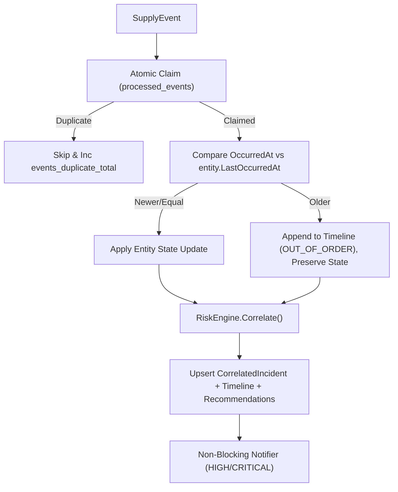

# Architecture Guide

## Hexagonal Layer Boundaries

1. **`internal/domain/` (Pure Core):**
   - Zero external I/O, zero HTTP/SQL/Redis imports.
   - Owns entity definitions (`models.go`), deterministic scoring/shortage/correlation/ranking (`risk_engine.go`), change proposal state machine invariants (`governance.go`), and prompt-injection fencing/redaction (`injection.go`).
2. **`internal/application/` (Orchestration & Ports):**
   - Declares outbound ports (`Repository`, `EventBroker`, `AIInvestigator`, `Notifier`) in `ports.go`.
   - Implements concurrent event processing (`Processor`), AI investigation orchestration (`InvestigationService`), human-in-the-loop governance workflows (`GovernanceService`), Prometheus metric collection (`Metrics`), and alert sinks (`Notifier`).
3. **`internal/infrastructure/` (Adapters & Transports):**
   - `config/`: Startup env loader & validator.
   - `sqlite/`: Pure-Go SQLite repository with WAL mode and `//go:embed` versioned migrations.
   - `broker/`: Bounded channel `MemoryBroker` and optional `RedisBroker` (Redis Streams).
   - `ai/`: `HTTPInvestigator` (Ollama & OpenAI-compatible) with timeouts, retries, circuit breaker, strict schema validation, and `NoneInvestigator`.
   - `httpapi/`: Go 1.22+ `net/http` router, RBAC middleware, per-IP token bucket limiter, narrow CORS, `X-Correlation-ID`, RFC 9457 Problem Details.

## Deterministic-First Execution Flow

## Graceful Shutdown Sequence

1. `SIGINT` / `SIGTERM` received by `cmd/server/main.go`.
2. `http.Server.Shutdown(ctx)` stops accepting new HTTP connections and drains in-flight requests.
3. `Processor.Shutdown(ctx)` rejects new enqueues, closes the `EventBroker` channel/stream, and waits via `sync.WaitGroup` until every buffered event finishes processing or the drain timeout expires.
4. SQLite store closes cleanly after flushing WAL checkpoints.
