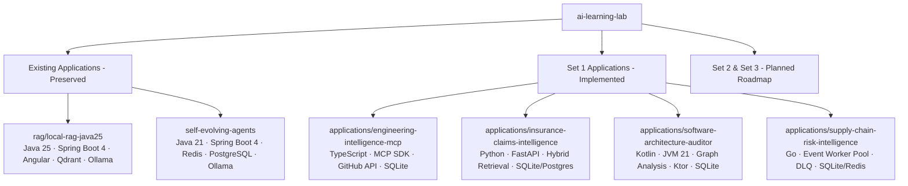

# AI Learning Lab — Portfolio Architecture Overview

This repository is organised as a **catalogue of independent AI applications**, not a monolithic multi-service platform. Each application solves a distinct business problem using the language, runtime, persistence model, and AI pattern best suited to that problem.

## Portfolio Map

## Shared Architectural Invariants

While each application selects its own stack and internal modules independently, all Set 1 applications enforce the same core engineering boundaries:

1. **Hexagonal separation (Domain / Application / Infrastructure):** Core business logic, algorithms, state machines, and invariants live in pure domain modules without direct dependency on HTTP frameworks, databases, or LLM SDKs.
2. **Authoritative deterministic logic:** Risk scores, dependency graphs, circular-dependency detection, policy coverage checks, permission gates, and confirmation tokens are deterministic. LLMs generate explanations, summaries, and grounded extractions—never authoritative decisions.
3. **Human-in-the-loop governance:** Consequential write operations require explicit human approval or signed confirmation tokens enforced server-side.
4. **Provider isolation & offline testability:** AI/embedding/external providers sit behind explicit outbound ports, support configurable local or cloud-compatible backends, and are exercised with contract tests and fixed offline evaluation suites in CI without paid API keys.
5. **Reproducible local operation:** Every application provides `.env.example`, startup configuration validation, migrations, sample datasets, health/readiness endpoints, structured logs, metrics, Dockerfile, and Docker Compose setup.
