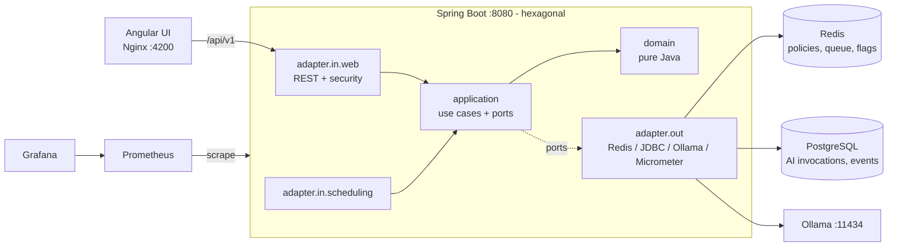

# Governed Self-Evolving Traffic Control

A local-first Spring Boot + Angular demo in which a traffic-management policy is **proposed by an LLM (Ollama), independently validated, evaluated against the current baseline, approved by a human, activated and — if needed — rolled back**. It includes a Redis-backed rate limiter and FIFO waiting room, a simulated shop endpoint, full persistence of every AI prompt/response, Prometheus/Grafana, k6 load tests and an Angular admin dashboard.

> **Scope.** A deliberately small engineering demo, not a production gateway. Traffic metrics shown in the UI are **observed** by the backend process (in-process, reset on restart). Candidate evaluation figures are **simulated** (deterministic replay) and are labelled as such everywhere. The AI never changes the active policy; it only recommends.

## Architecture in one picture



Details: [docs/ARCHITECTURE.md](docs/ARCHITECTURE.md), [docs/AI_EVOLUTION_FLOW.md](docs/AI_EVOLUTION_FLOW.md), [docs/OBSERVABILITY.md](docs/OBSERVABILITY.md), [docs/API.md](docs/API.md), [docs/TESTING.md](docs/TESTING.md), [docs/REFACTORING_CHANGELOG.md](docs/REFACTORING_CHANGELOG.md).

## Prerequisites

- Docker + Docker Compose v2 (about 6 GB RAM free; Ollama is CPU/RAM hungry)
- Optional for development: JDK 21, Node 22+ (Angular 22), npm

## Run locally

```bash
cp .env.example .env            # then set DEMO_ADMIN_TOKEN, DEMO_DB_PASSWORD, GRAFANA_PASSWORD
docker compose up --build -d
docker compose --profile setup run --rm ollama-pull   # one-time model download (default qwen2.5:3b)
```

| Service | URL | Notes |
|---|---|---|
| Angular UI | http://localhost:4200 | sign in with `DEMO_ADMIN_TOKEN`; `/api` is proxied to the backend by Nginx |
| Backend / OpenAPI | http://localhost:8080 · `/swagger-ui.html` | admin endpoints need the token |
| Prometheus | http://localhost:9090 | scrapes `app:8080/actuator/prometheus` |
| Grafana | http://localhost:3000 | user `admin`, password `GRAFANA_PASSWORD`; dashboard "Self-Evolving Traffic Demo" is pre-provisioned |
| Ollama | http://localhost:11434 | models stored in the `ollama-data` volume |

Startup order is enforced by health checks: `redis` + `postgres` (healthy) → `app` → `frontend`/`prometheus` → `grafana`. `ollama` is independent; the app starts and serves traffic without it (deterministic behaviour only).

Smoke test the whole stack: `sh scripts/compose-smoke.sh`. Load test: `docker compose --profile load run --rm k6`.

## Reproduce an AI evolution cycle

1. Open the UI → **Settings** → enable **AI**. Confirm Ollama shows *Connected* and the model is *installed* (otherwise run the `ollama-pull` command above).
2. Generate traffic, e.g. `docker compose --profile load run --rm k6` (or `for i in $(seq 300); do curl -s localhost:8080/api/v1/shop >/dev/null & done`). At least 20 arrivals in the last 60 s are required, otherwise the cycle stops with `INSUFFICIENT_DATA` and **no model call** is made.
3. **Policies** → *Run AI evolution cycle* (or enable *Automatic evolution* for scheduled cycles).
4. Inspect **AI Inspector**: exact prompt, raw Ollama response, parsed decision, independent validation. **Evolution Timeline** shows the lifecycle; **Experiments** compares baseline vs candidate (simulated).
5. **Policies** → *Approve* (only enabled after a passing evaluation; asks for confirmation) or *Reject*. *Roll back* restores the previous version.

Without Ollama you can exercise the governance path deterministically: *Propose deterministic candidate* → *Evaluate now* → *Approve*.

> Local CPU inference can be slow. The default timeout is 90 s (`DEMO_AI_TIMEOUT`); a timed-out call is recorded as `TIMEOUT` and the cycle fails safely.

## Security model

- `/api/v1/shop`, `/api/v1/system/health`, `/actuator/health|prometheus` and the OpenAPI docs are public; **every other API requires the admin token** (`X-Demo-Admin: <token>` or `Authorization: Bearer <token>`). The backend refuses to start without a token of at least 12 characters.
- The UI keeps the token in `sessionStorage` (tab-scoped). Strict CORS (`DEMO_CORS_ALLOWED_ORIGINS`), stateless sessions, ProblemDetail errors without stack traces, audited admin actions.
- Prompts treat telemetry/history as fenced untrusted data; secrets and bearer tokens are redacted before AI records are stored; retention is configurable.

## Develop

```bash
./gradlew test                       # backend (JDK 21)
cd frontend && npm ci && npm test    # Angular unit tests (Vitest)
cd frontend && npm start             # dev server with proxy to localhost:8080
./gradlew :frontend:ngBuild          # Angular build through Gradle (Node plugin)
```

Run the backend locally: start Redis + PostgreSQL (`docker compose up -d redis postgres`), then
`DEMO_ADMIN_TOKEN=<token> DEMO_DB_PASSWORD=<pw> ./gradlew bootRun`.

## Configuration

See [.env.example](.env.example) (all variables documented) and `src/main/resources/application.yml`. Runtime flags (AI, automatic evolution, model, trigger threshold) can be changed live from the UI/API and are persisted in Redis; the environment values are only defaults. **No restart is needed for flags; changes to the Ollama URL/timeouts, evolution interval and retention require one.**
