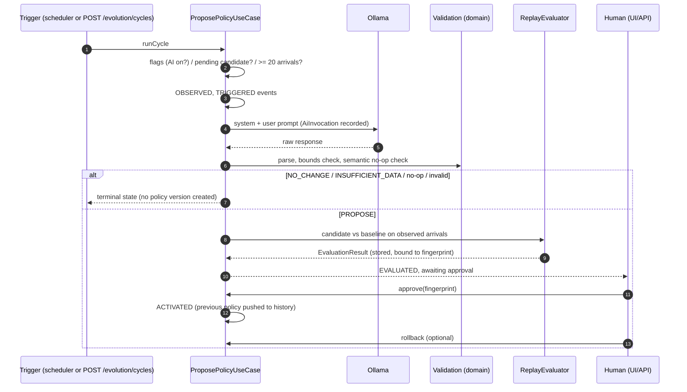

# AI Evolution Flow

## Lifecycle stages (`EvolutionStage`)

`OBSERVED → TRIGGERED → AI_CALLED → PROPOSED → EVALUATED → APPROVED → ACTIVATED`; terminal: `NO_CHANGE`, `INSUFFICIENT_DATA`, `REJECTED`, `FAILED`, `ROLLED_BACK`. Each stage is persisted as an `evolution_event` and shown in the Timeline.

| # | Step | Where |
|---|---|---|
| 1 | Collect metrics | `RedisTrafficTelemetry` (arrivals via Redis, other metrics in-process, labelled `OBSERVED`) |
| 2 | Detect trigger | scheduler: automatic flag + AI flag + arrivals in last 60 s ≥ trigger threshold (default 120); manual: ≥ 20 arrivals |
| 3 | Construct prompt | `PromptBuilder` (system prompt + user prompt; metrics and prior experiments are fenced as untrusted data) |
| 4 | Call Ollama | `OllamaPolicyAdvisor` → `/api/chat`, `format=json`, temperature 0.2, `num_predict` 300, timeout 90 s, ≤ 1 retry on I/O errors (never on timeout) |
| 5 | Capture raw response | exact request payload and response body stored unmodified |
| 6 | Parse/validate | `OllamaResponseParser`; bounds: admission 1..1000, queue 1..10000 (hard policy bounds 1..5000 / 0..100000) |
| 7 | No-op detection | `TrafficPolicy.sameBehavior` → `NO_CHANGE` with outcome `NO_OP_PROPOSAL`; **no candidate, no version** |
| 8 | Evaluate | `ReplayEvaluator` replays observed arrivals through baseline and candidate (simulated) |
| 9 | Governance gates | p95 ≤ 150 ms, error fraction ≤ 1 %, p95 wait ≤ 30 s, queue drained, no fewer completions, no more rejections, measurable benefit |
| 10 | Human approval | `POST /policies/candidate/approve` with the candidate fingerprint |
| 11 | Activate | `PolicyRepository.activate`; history keeps the previous policy |
| 12 | Observe / roll back | `POST /policies/rollback` restores the previous policy |
| 13 | Persist lessons | the experiment (decision, evaluation, outcome) is stored and the most recent ones are fed into the next prompt |

## Decisions

- `PROPOSE` can raise or lower the admission rate and adjust queue capacity within bounds. There is **no downward-only constraint**.
- `NO_CHANGE` / `INSUFFICIENT_DATA` keep the active policy.
- The AI never writes the active policy.

## Feature-flag behaviour

| State | Effect |
|---|---|
| AI disabled | `POST /evolution/cycles` → 409 `feature-disabled`; scheduler does nothing; **no Ollama call** |
| Automatic disabled | scheduler never calls the AI; manual cycles still work if AI is on |
| AI disabled after approval | active policy keeps running; **no rollback** |
| Ollama down / timeout | invocation recorded as `FAILED`/`TIMEOUT`, cycle `FAILED`, API returns 502; deterministic admission continues |

## Deterministic path (no LLM)

`POST /policies/candidates/deterministic` creates a candidate at 80 % of the active admission rate; evaluate and approve it exactly like an AI candidate.

## Honesty about measurements

Evaluation results are **simulated** (traceSource `OBSERVED_ARRIVALS` replayed through a model, or `SYNTHETIC_SCENARIO` when too little traffic was seen). They are never presented as measured HTTP results; measured values come only from `/traffic/*` and Prometheus.
