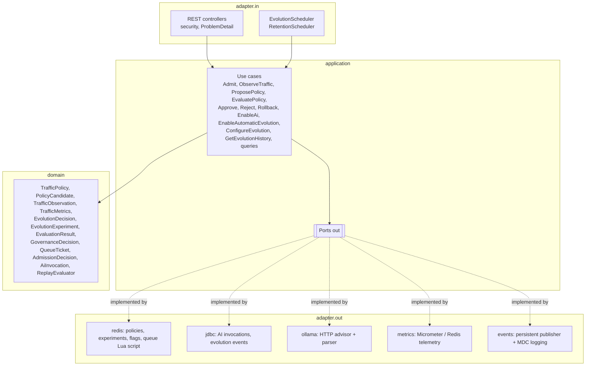

# Architecture

The backend is one Spring Boot module organised as **Hexagonal Architecture (Ports and Adapters)**. Dependencies only point inwards: `adapter → application → domain`. This is enforced by ArchUnit (`HexagonalArchitectureTest`).

## Packages

| Package | Contents | May depend on |
|---|---|---|
| `domain` | Immutable records and pure logic: bounds/invariants (`TrafficPolicy`, `PolicyCandidate.violations`), semantic no-op detection (`TrafficPolicy.sameBehavior`), `ReplayEvaluator`, governance record | JDK only |
| `application.usecase` | One class per use case + `PromptBuilder`, `Redactor`, `EffectiveFlags` | domain, application ports/models (no Spring, no Jackson, no logging) |
| `application.port.out` | `PolicyRepository`, `ExperimentRepository`, `TrafficMetricsPort`, `AiPolicyAdvisorPort`, `QueueRepository`, `FeatureFlagRepository`, `EvolutionEventPublisher`, `EvolutionEventRepository`, `AiInvocationRepository`, `OperationalMetricsPort`, `JsonCodec`; `java.time.Clock` is the clock port | domain |
| `adapter.in.web` | Controllers, DTOs, `SecurityConfiguration`, `AdminTokenFilter`, `RequestCorrelationFilter`, `GlobalExceptionHandler` | application, Spring |
| `adapter.in.scheduling` | Scheduled evolution trigger, per-second sampling, 30 s traffic summary log, retention purge | application |
| `adapter.out.*` | Redis, JDBC, Ollama, Micrometer, event publisher | application ports, frameworks |
| `config` | `UseCaseConfiguration` (composition root), `DemoProperties` | everything |

Logging happens in adapters only (the application layer stays framework-free); `PersistentEvolutionEventPublisher` logs each lifecycle event with MDC fields and persists it.

## Data stores

| Store | What | Why |
|---|---|---|
| Redis | Active/candidate policy, evaluation bound to the candidate, policy history, experiments (last 100), feature flags, waiting-room queue and tickets, per-second admission/arrival counters | fast shared state, atomic Lua admission, AOF enabled in Compose |
| PostgreSQL | `ai_invocation` (exact prompts/responses/validation), `evolution_event` (timeline and diagnostics) | durable, queryable, paginated history with retention (Flyway-managed schema) |
| In-process | Per-second traffic buckets (15 min), Micrometer meters | reset on restart; labelled `OBSERVED` |

## Key design decisions

- **Advisory AI.** The AI returns a decision; only `ApprovePolicyUseCase` can activate a policy and it requires (a) a pending candidate whose fingerprint equals the one named in the request, (b) a stored evaluation for the same fingerprint that passed, (c) that the candidate's baseline is still the active version, (d) that it is not a no-op.
- **Fingerprint binding.** `version:mode:admission:maxQueue:workMs` ties approval to the exact evaluated candidate (evaluation is stored together with the candidate and deleted with it).
- **Single security boundary.** `AdminTokenFilter` (constant-time comparison) protects everything except the public shop/health/metrics endpoints.
- **No new frameworks.** Use cases are plain classes wired in `UseCaseConfiguration`; no CQRS/event-sourcing/mapping libraries.

See [REFACTORING_PLAN.md](REFACTORING_PLAN.md) for the analysis of the original code.
